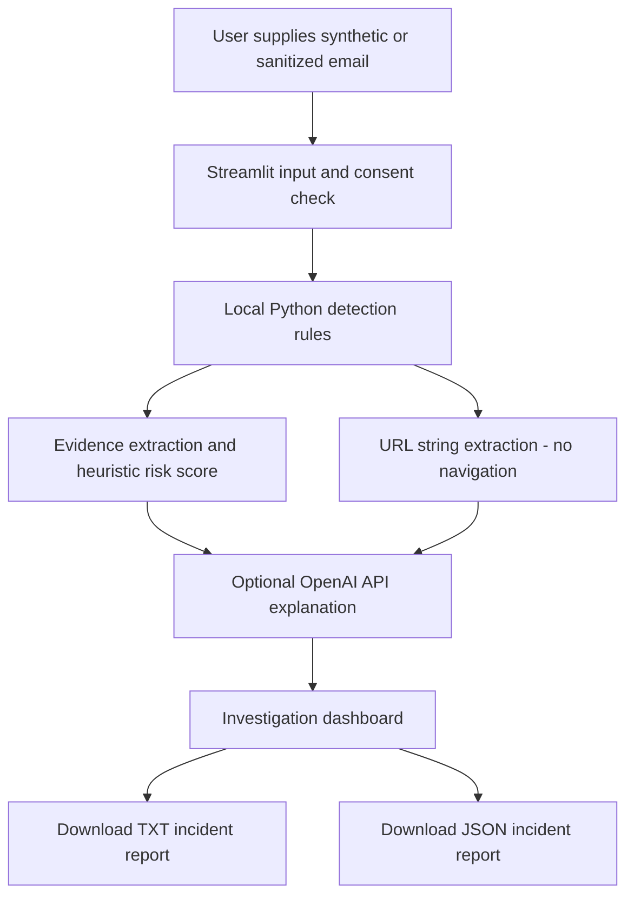

# PhishGuard AI — Architecture

## Component overview

## Data flow

1. The user pastes an email sample and confirms that sensitive data has been removed.
2. Local Python rules look for configured urgency, credential, payment, threat/reward phrases and URL strings.
3. Matched categories contribute fixed points to a capped 0–100 heuristic score.
4. If an API key is configured, the email text and local findings are sent to the selected OpenAI model for an explanation.
5. Streamlit presents evidence, score, risk band, AI notes (if available), and downloadable TXT/JSON reports.
6. Dashboard history is stored in Streamlit session state and is not a persistent case-management database.

## Risk score model

| Signal | Points |
|---|---:|
| Urgency or pressure | 20 |
| Credential request | 25 |
| Payment or financial pressure | 20 |
| Threat or reward language | 15 |
| One or more URLs extracted | 10 |

The score is capped at 100. Bands: 0–24 Lower concern; 25–59 Needs caution; 60–100 High concern. These are illustrative, uncalibrated rules—not probabilities.

## Trust boundaries and limitations

- Email body is untrusted input; model instructions explicitly say not to follow embedded instructions.
- URLs are extracted as strings only. The app does not visit them.
- The app does not authenticate senders, validate SPF/DKIM/DMARC, inspect attachments, or query reputation services.
- AI analysis requires an API key and is subject to provider processing terms/settings.
- No persistent incident database or user authentication is implemented.
